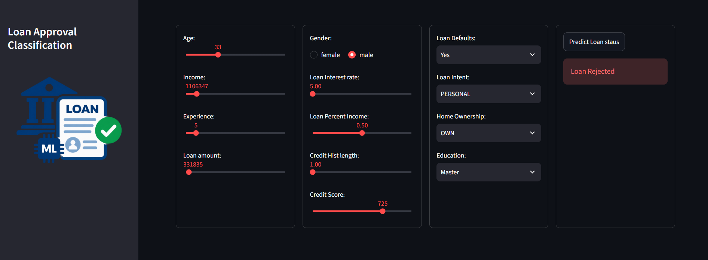

# Loan Approval Classification Using Machine Learning

## Project Overview

This project develops a machine learning-based Loan Approval Classification system to predict whether a loan application should be approved or rejected based on applicants' personal, financial, and credit-related information. It combines data analysis, multiple machine learning algorithms, model evaluation, and an interactive Streamlit web application.

## Technologies Used

Python: Core programming language for data analysis and machine learning.
Jupyter Notebook: Used for exploratory data analysis, model development, and experimentation.
Streamlit: Used to develop the interactive loan approval prediction web application.
Machine Learning: Used to train, evaluate, and compare classification algorithms.
Git & GitHub: Used for project version control and repository management.
Pandas: Dataset loading, manipulation and preprocessing.
NumPy:	Numerical computations.
Matplotlib:	Data visualization.
Seaborn: Exploratory data analysis.
Scikit-learn: Machine learning model development.
Streamlit: Interactive web application development.
Pickle: Saving and loading the trained model.

## Key Features

- Exploratory Data Analysis (EDA)
- Data cleaning and preprocessing
- Missing value and duplicate detection
- Numerical feature scaling using StandardScaler
- Categorical feature encoding using OneHotEncoder
- Train-test data splitting
- Multiple machine learning model training
- Model performance comparison
- Best model selection
- Model serialization using Pickle
- Interactive Streamlit web application
- Real-time loan approval prediction

## Machine Learning Algorithms

Five classification algorithms are implemented and compared:

- Logistic Regression
- Gaussian Naive Bayes
- Support Vector Machine (SVM)
- Decision Tree Classifier
- Random Forest Classifier

## Key Performance Metrics

The models are evaluated using accuracy score on a 70:30 training-testing split.

| Algorithm | Accuracy |
|---|---:|
| Logistic Regression | 85.67% |
| Gaussian Naive Bayes | 73.27% |
| Support Vector Machine | 91.37% |
| Decision Tree | 91.13% |
| Random Forest | 91.89% |

**Best Performing Model:** Random Forest Classifier

**Best Model Accuracy:** 91.89%

## Dataset Features

The dataset contains 45,000 records and 14 columns, including:

- Applicant age
- Gender
- Education
- Annual income
- Employment experience
- Home ownership
- Loan amount
- Loan intent
- Loan interest rate
- Loan percentage of income
- Credit history length
- Credit score
- Previous loan defaults
- Loan status (Target Variable)

## Data Preprocessing

The project uses Scikit-learn's ColumnTransformer and Pipeline to automate preprocessing.

- **StandardScaler:** Standardizes numerical features.
- **OneHotEncoder:** Converts categorical variables into numerical representations.
- **Train-Test Split:** Divides the dataset into 70% training and 30% testing data.
- **Pickle:** Saves the best-performing trained pipeline for future predictions.

## Streamlit Application

An interactive web application is developed using Streamlit. Users can enter applicant details through sliders, radio buttons, and dropdown menus.

The application loads the saved Random Forest pipeline and predicts the loan application status.

The prediction results are displayed as:

- **Loan Approved**
- **Loan Rejected**

## Project Files

- `experiments.ipynb` – Data analysis, preprocessing, model training, and evaluation.
- `app.py` – Streamlit web application.
- `loan_data.csv` – Loan applicant dataset.
- `best_model_pipeline.pkl` – Saved best-performing machine learning pipeline.
- `models_perf_dataset.csv` – Model accuracy comparison results.
- `logo.png` – Application logo.

## Technologies Used

Python, Pandas, NumPy, Matplotlib, Seaborn, Scikit-learn, Streamlit, Pickle, and Jupyter Notebook.

## How to Run the Project

**1. Install the required libraries**

```bash
pip install numpy pandas matplotlib seaborn scikit-learn streamlit
```

**2. Run the Streamlit application**

```bash
streamlit run app.py
```

**3. Open the application**

Access the local URL displayed in the terminal to interact with the loan prediction dashboard.

## Dashboard Purpose

This application helps demonstrate how machine learning can be used to classify loan applications based on financial and credit-related attributes. It provides an interactive interface for exploring applicant information and generating predictions using a trained classification model.

## Final Conclusion

The Loan Approval Classification project successfully implements an end-to-end machine learning workflow, from exploratory data analysis and preprocessing to model training, evaluation, and deployment. Among the five algorithms, Random Forest achieved the highest accuracy of **91.89%**. The integration of the trained model with Streamlit makes loan classification interactive and accessible, demonstrating the practical application of machine learning in financial decision-support systems.

## 📷 Dashboard Preview



